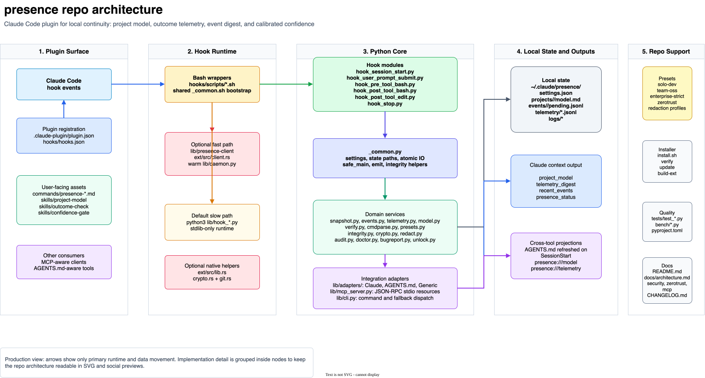

# presence

[](https://github.com/sara-star-quant/presence/actions/workflows/ci.yml)
[](https://www.bestpractices.dev/projects/13085)
[](https://github.com/sara-star-quant/presence/releases)
[](LICENSE)
[](.github/workflows/ci.yml)
[](fuzz)

**Every Claude Code session starts cold. presence makes the next one start where the last one left off.**

A Claude Code plugin that keeps a local, per-repo memory of what Claude learned and what happened to its changes. Read-only projections (an MCP server and an AGENTS.md adapter) let other MCP-aware and AGENTS.md-aware tools read the same context.



One install, no per-project setup, four additions to Claude Code:

1. **Living project model.** Claude builds and reuses notes about each repo it touches, instead of re-deriving the architecture every session.
2. **Outcome telemetry.** Tracks what Claude committed, then watches for reverts, amends, and PR closes. Later sessions see "your last 3 changes here were reverted within 24h".
3. **Event digest.** File changes, test failures, and build results that happened between turns surface at the next prompt.
4. **Calibrated confidence.** The Stop hook checks whether success claims ("fixed", "done", "works") are backed by verification (tests run, build green) since the change, and warns when they are not. An optional hard gate covers `git commit` and `git push`.

State lives in `~/.claude/presence/`, local only.

## Status

Pre-1.0 (0.11.x). Read this before depending on it.

- **Contract.** Preset keys, hook events, and CLI commands are additive-only within 0.x, enforced by `tests/test_contract.py` ([`docs/contract.md`](docs/contract.md)). Older state keeps opening: CI runs the current hooks against state generated by earlier releases, back to v0.7.1.
- **Host compatibility.** presence runs inside Claude Code and depends on its hook contract. There is no tested-version matrix yet; that is an open gap in [`docs/v1-readiness.md`](docs/v1-readiness.md), along with the other things between here and 1.0.
- **Testing.** 534 tests across Linux (x86_64, arm64) and macOS, Python 3.12 to 3.14. The snapshot, audit, and redaction parsers are fuzzed with Hypothesis on every PR and with Atheris under ClusterFuzzLite nightly.
- **Maintenance.** Single maintainer; see [`GOVERNANCE.md`](GOVERNANCE.md) for the continuity plan.

## Install

```bash
curl -fsSL https://raw.githubusercontent.com/sara-star-quant/presence/main/install.sh | bash
~/.claude/plugins/presence/install.sh --verify
```

Restart Claude Code and run `/presence-status`.

The installer is idempotent and makes no outbound network calls beyond fetching itself. It checks for Python 3.12+, symlinks the plugin into `~/.claude/plugins/presence`, creates `~/.claude/presence/` with `0700` perms, generates `MANIFEST.lock`, and pre-compiles `lib/`. Without Python 3.12+ it warns and continues; presence stays inactive until one is on `PATH`. Add `-s -- --bootstrap` to install Python 3.13 through [uv](https://github.com/astral-sh/uv) (one call to astral.sh, opt-in).

`--verify` checks the symlink, plugin registration in `settings.json`, perms, Python, the `MANIFEST.lock` integrity, and fires all 6 hooks against the real `lib/` tree. Exit 0 means ready; `FAIL` lines say what is missing; `--verify --json` is machine-readable. From inside Claude Code, `/presence-status` shows the active preset and store sizes (`--zerotrust` for that preset's checklist), and `/presence-doctor` runs the full diagnostic. `/presence-doctor --fix` repairs recoverable problems: perm drift, a missing manifest, a stale `.integrity-blocked` marker.

### Other install methods

Plugin marketplace:

```
/plugin marketplace add github.com/sara-star-quant/presence
/plugin install presence
```

Git clone:

```bash
git clone https://github.com/sara-star-quant/presence ~/code/presence
~/code/presence/install.sh
```

The Zero-Trust preset's at-rest encryption (opt-in) also needs the `cryptography` library in the Python presence uses. Homebrew and most distros mark the system Python as PEP 668 externally managed, so pick the path that matches how you got Python:

```bash
# A. You used --bootstrap (presence has its own uv-managed Python).
"$(cat ~/.claude/presence/.python_bin)" -m pip install cryptography

# B. Homebrew or system Python, overriding PEP 668 (user site, not system).
python3 -m pip install --user --break-system-packages cryptography

# C. Isolated: a venv that presence is pinned to.
python3 -m venv ~/.claude/presence-venv
~/.claude/presence-venv/bin/pip install cryptography
echo "$HOME/.claude/presence-venv/bin/python3" > ~/.claude/presence/.python_bin
```

If unsure which Python presence uses, `/presence-doctor` prints it on the `pinned python` and `python` lines. Every other preset and the rest of the Zero-Trust controls are stdlib-only.

### Update

For installs from curl or git clone:

```bash
~/.claude/plugins/presence/install.sh --update
```

This runs `git fetch`, `git pull --ff-only`, and the installer again, and refuses to run on a dirty working tree. Installs from the `/plugin` flow update through Claude Code's own plugin update.

To see the latest release in `/presence-doctor`, set `{ "update_check": { "enabled": true } }` in `~/.claude/presence/settings.json`. It makes one anonymous HTTPS GET to `api.github.com` per 24 h, is off by default, and is forced off under `zerotrust`. `/presence-doctor --refresh` bypasses the cache.

### Uninstall

```
/plugin uninstall presence
```

or `~/.claude/plugins/presence/install.sh --uninstall` for a local install. State in `~/.claude/presence/` is kept unless you pass `--purge`. Under Zero-Trust, also run `/presence-reset --crypto` to rotate the keychain key and wipe encrypted state.

## Security model

Full threat model: [`docs/security.md`](docs/security.md), T1 to T12, each pinned by a named test.

- **Local only.** No analytics, no remote telemetry. Default presets make no outbound calls; the opt-in ones (`gh` PR status, release check, webhook notifier, `--bootstrap`, `--download-ext`) are off by default and forced off under `zerotrust`.
- **Secrets are redacted before anything is written** to events or telemetry. Composable profiles for EU PII, US PII, and PCI-DSS are in [`presets/redaction/`](presets/redaction/); [`docs/compliance.md`](docs/compliance.md) states what that does and does not cover.
- **State is private to your user.** Directory `0700`, files `0600`, re-tightened every SessionStart.
- **Zero-Trust preset.** AES-GCM at rest with a keychain-held key, a hash-chained audit log, and fail-closed integrity checks: a broken chain or a tampered plugin keeps the hooks inert rather than running on state it cannot trust. Details in [`docs/zerotrust.md`](docs/zerotrust.md).
- **Not defended:** a compromised Claude Code binary, or a compromised local account. The account owner can rewrite the whole audit log; the chain detects edits and truncation, not a full rewrite. The commit and push gate is an advisory nudge, not an access control, and is trivially bypassable.

Release binaries are verified against `SHA256SUMS` at install time; see [`SECURITY.md`](SECURITY.md#release-binaries). Report vulnerabilities privately through [`SECURITY.md`](SECURITY.md), not as public issues.

## Presets

`presence` ships four presets. Switch any time:

```
/presence-preset use solo-dev
/presence-preset use team-oss
/presence-preset use enterprise-strict
/presence-preset use zerotrust
```

| Preset | Model | Telemetry | Commit gate | Stop gate | At rest |
|---|---|---|---|---|---|
| `solo-dev` (default) | on, terse | on, no PR check | off (advisory only via Stop) | silent (logged, surfaced next session) | plain |
| `team-oss` | on, verbose | on, optional PR check | warn (advisory text injected) | silent | plain |
| `enterprise-strict` | on, verbose, audit | on, audit log | block (refuses commit) | block (re-prompts on unverified success) | plain |
| `zerotrust` | on, encrypted, audit | on, encrypted, audit, no PR check | block | block | AES-GCM + keychain |

Custom presets: drop `<name>.json` in `~/.claude/presence/presets/` and switch to it. See [`docs/recipes.md`](docs/recipes.md) for common customizations.

## Performance and platforms

| Metric | Default (stdlib) | With the Rust client | Method |
|---|---|---|---|
| Cold hook startup | 82 ms median | **8.9 ms median** | n=50 / n=30, `bench/cold_startup.py` |
| SessionStart populated | 112 ms median | **9.1 ms median** | 10 KB model + 100 events + 50 claims |
| Aggregate session (77 fires) | 6.4 s | **770 ms** | n=10 / n=5, `bench/aggregate_session.py` |
| Install + first /presence-status | 245 ms total | 245 ms total | n=25, `bench/install_to_working.py` |

The Rust client is optional: `./install.sh --build-ext` compiles it locally (needs a Rust toolchain at install time), `--download-ext` fetches a checksum-verified pre-built binary matching your checkout. Without it, hooks run on the stdlib-only path. Runtime dependencies: none by default, `cryptography` only for Zero-Trust at-rest encryption. All measurements: macOS arm64, Python 3.14.4. Reproduce with `python3 bench/<name>.py --runs N` ([`bench/README.md`](bench/README.md)); version-by-version history in [`bench/HISTORY.md`](bench/HISTORY.md).

Surface: 4 presets, 6 hooks, 7 slash commands, 3 skills, 1 subagent, 1 MCP server, 1 cross-tool adapter, 3 redaction profiles.

| Platform | Python hooks | Pre-built Rust client | Tests in CI |
|---|---|---|---|
| macOS arm64 | supported | yes | yes |
| macOS x86_64 | supported | yes (cross-built) | no, no runner |
| Linux x86_64 | supported | yes | yes |
| Linux arm64 | supported | yes | yes |
| Windows via WSL2 | supported (it is Linux) | follows the WSL distro | no |
| Windows native | unsupported ([#9](https://github.com/sara-star-quant/presence/issues/9)) | no | no |

## Documentation

Start at [`docs/index.md`](docs/index.md). Highlights:

- [`docs/architecture.md`](docs/architecture.md): what each hook does, how state is laid out, the context schema, how to write a custom preset
- [`docs/security.md`](docs/security.md): threat model, and the test that pins each claim
- [`docs/zerotrust.md`](docs/zerotrust.md): the opt-in Zero-Trust profile
- [`docs/compliance.md`](docs/compliance.md): what presence does and does not do for regulated workloads (no certification framing)
- [`docs/contract.md`](docs/contract.md): the compatibility promise
- [`docs/v1-readiness.md`](docs/v1-readiness.md) and [`docs/roadmap.md`](docs/roadmap.md): what is open before 1.0, and what we deferred and why
- [`docs/mcp.md`](docs/mcp.md), [`docs/multi-host.md`](docs/multi-host.md): the read-only projections for other tools
- [`docs/recipes.md`](docs/recipes.md), [`docs/glossary.md`](docs/glossary.md)
- [`CHANGELOG.md`](CHANGELOG.md), [`CONTRIBUTING.md`](CONTRIBUTING.md), [`SECURITY.md`](SECURITY.md), [`llms.txt`](llms.txt)

## Reporting bugs

Open a GitHub issue using the bug template. If presence is installed but silent (no hooks firing, or an unexpected integrity or audit block), use the [it went inert](https://github.com/sara-star-quant/presence/issues/new?template=inert.yml) template and paste the output of `/presence-bugreport`. For security findings, do **not** file a public issue - follow the private disclosure process in [`SECURITY.md`](SECURITY.md).

## Disclaimer

`presence` is provided **as is** under the [Apache License 2.0](LICENSE), without warranty of any kind, express or implied. The authors and copyright holders (Sara Star Quant LLC) and any contributors are **not responsible** for any damage, data loss, security incident, regression, lost productivity, or other adverse outcome arising from the installation or use of this plugin.

This project is **not advice** of any kind:

- **Not legal advice.** The security model documented in [`docs/security.md`](docs/security.md) and [`docs/zerotrust.md`](docs/zerotrust.md) is informational. It is not a compliance attestation, certification, or guarantee under any regulatory framework (GDPR, HIPAA, SOC 2, ISO 27001, etc.). If you operate in a regulated environment, consult qualified counsel before relying on this plugin's properties.
- **Not security advice.** The Zero-Trust preset reduces attack surface and adds layered controls (encryption at rest, audit log, fail-closed integrity, hard commit gates) but is **not** a substitute for proper threat modeling, penetration testing, or operational security review in your specific environment.
- **Not engineering advice.** The calibrated-confidence gate and the living project model are useful nudges, **not** proofs of correctness. They reduce one common failure mode (asserting completion without verification); they do not replace tests, code review, or your own judgment.

By installing or using `presence`, you accept full responsibility for:

- Reviewing the source before running it on your system or in any session that touches sensitive data.
- Verifying that the documented properties (no network egress, local-only state, redaction patterns, encryption format, etc.) actually match what your environment requires.
- Any downstream consequences of decisions made or claims accepted while presence was active in your sessions, including but not limited to: code committed, code reverted, settings changed, and inferences drawn from the project model or telemetry digest.

The full legal terms are in [LICENSE](LICENSE). This README's Disclaimer section is an informational summary of the spirit of those terms; in any conflict, the LICENSE controls.

## License

Apache-2.0, see [LICENSE](LICENSE).
