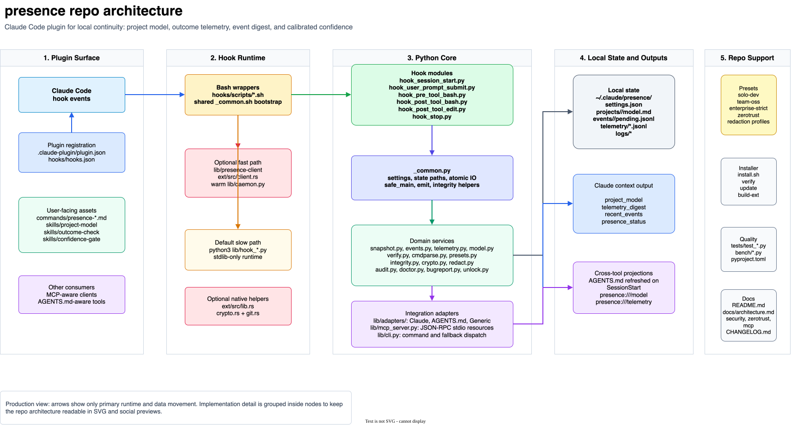

# presence: architecture



## Pillars and mechanisms

| Pillar | Hook / component | Behavior |
|---|---|---|
| Living project model | `SessionStart` | Loads `~/.claude/presence/projects/<repo-id>/model.md` into context at session start, truncated to a token budget. The `model-curator` agent compresses raw observations on demand via `/presence-curate`. Under a preset that encrypts the model, each entry is stored as one AES-GCM envelope and read back as text (`lib/cli.py model show`, `model replace`). |
| Outcome telemetry | `PostToolUse(Bash)` + `SessionStart` | Detects `git commit`, `git push`, `gh pr create` via `cmdparse` (shlex-based, not regex) and records SHA + Claude's stated intent into `~/.claude/presence/telemetry/claims.jsonl`. On the next session start, scans `git log` since `last_seen` for revert commits touching tracked SHAs and surfaces a digest. |
| Event digest | `PostToolUse(Edit/Write)` + `PostToolUse(Bash)` + `UserPromptSubmit` | Edits and bash command results (with classification: `test_pass`/`test_fail`/`build_pass`/`build_fail` for ~17 known commands) are appended to `~/.claude/presence/events/<repo-id>/pending.jsonl`. `SessionStart` and `UserPromptSubmit` drain (read + truncate) and inject a digest as `additionalContext`. |
| Calibrated confidence | `Stop` + `PreToolUse(Bash)` | `Stop` parses the final assistant message for unhedged success claims and cross-references the event log. If no test/build pass since the most recent edit, logs to `confidence.jsonl`. In strict presets (`enterprise-strict`, `zerotrust`), emits `{"decision":"block","reason":...}` to re-prompt the model; in default presets, just records and surfaces via the warning counter at the next `SessionStart`. `PreToolUse(Bash)` on `git commit`/`push` consults the same evidence, with mode determined by `confidence.commit_gate` (`off`/`warn`/`ask`/`block`). Every `confidence.jsonl` write also offers the verdict to `lib/notify.py`'s optional webhook (opt-in via `notify.enabled`; off by default and hard-disabled under `zerotrust`) -- see `docs/recipes.md`. |

## State layout

State lives **outside** the project repo to avoid polluting team workspaces:

```
~/.claude/presence/
|-- settings.json                       # active preset name + overrides
|-- presets/                            # user-defined presets (optional)
|-- projects/<repo-id>/
|   |-- model.md                        # living architecture + conventions notes (one envelope per entry when encrypted)
|   |-- worktree.json                   # session baseline and last-verified git tree (hashes only)
|   `-- last_seen                       # unix ts of last SessionStart in this repo
|-- telemetry/
|   |-- claims.jsonl                    # what Claude committed, per SHA
|   |-- outcomes.jsonl                  # detected reverts touching tracked SHAs
|   `-- confidence.jsonl                # stated confidence vs verification evidence
|-- events/<repo-id>/
|   `-- pending.jsonl                   # events accumulated since last drain
`-- logs/
    |-- errors.log                      # tracebacks from safe_main wrapper
    |-- warnings.log                    # structured non-fatal warnings
    |-- error_count                     # counter (read + reset by SessionStart)
    `-- warning_count                   # counter (read + reset by SessionStart)
```

`<repo-id>` is `sha256(git_remote_url || abspath(repo_root))[:12]`. Computed via `git rev-parse --show-toplevel`, falling back to the cwd hash for non-git directories.

## Hook flow per session

```
SessionStart
  |-- surface error/warning counters (if non-zero) and reset them
  |-- load model.md (truncated to model.max_tokens * 4 chars)
  |-- scan git log since last_seen for revert commits touching tracked SHAs
  |-- drain pending events into a digest
  `-- emit additionalContext with the assembled summary

[user types prompt]
  UserPromptSubmit
    |-- drain pending events (if any accumulated since SessionStart)
    `-- emit additionalContext with the digest (if non-empty)

[Claude works ...]
  PostToolUse(Edit|Write|MultiEdit)
    `-- append {ts, kind: "edit", tool, path} to pending.jsonl

  PostToolUse(Bash)
    |-- append {ts, kind: "bash", cmd (redacted), exit} to pending.jsonl
    |-- classify cmd via verify.classify_command (returns test_pass/build_fail/...)
    |       and append a typed event if it matched
    |-- if cmd parses as `git commit` (via cmdparse, not regex):
    |       parse SHA from tool_response.stdout, record claim
    `-- if cmd parses as `git push` or `gh pr create`: record push claim

  PreToolUse(Bash)
    `-- if cmd parses as `git commit` or `git push`:
         |-- check: any test_pass/build_pass since the most recent edit?
         |       (a test or build chained before the commit with && counts, if only cd, echo, git add or the like sits between: the commit only runs if it passed)
         `-- if no, behavior depends on confidence.commit_gate:
              - "off"   : do nothing
              - "warn"  : emit additionalContext advisory; allow
              - "ask"   : emit permissionDecision="ask" with reason
              - "block" : emit permissionDecision="deny" with reason

Stop
  |-- tail-read transcript (last 256 KiB) for the last assistant message
  |-- if it contains an unhedged success claim AND there's been a recent edit:
  |       - log to confidence.jsonl
  |       - if confidence.stop_action == "block": emit {"decision":"block","reason":...}
  |       - else: warn(unverified_success_claim) and let SessionStart surface it
  |       - if confidence.stop_action == "warn": also leave one fixed line (lib/notice.py) that the next
  |         UserPromptSubmit puts in the agent's context, once; "silent" (the default) leaves nothing
  `-- update last_seen for next session
```

## Verification by tree

The Edit and Write hooks cannot see an edit made by a shell command, an MCP tool, a subagent or a `git checkout`, so the gate does not rely on them. On the first prompt of a session `lib/worktree.py` records the working copy as a git tree, using a throwaway index and object directory (the repository gains no objects). A passing test or build run records the tree it ran on, and the Stop hook and the commit gate compare the current tree with it: code changed since the baseline and the last passing tree is not this tree means unverified. Which paths changed comes from blob ids per path against the session's starting tree, classified as code, docs or outside the project; paths are stored hashed and no content is kept.

Cost: about 0.1 s for a few thousand files, paid once per session start, per passing run, per claim at Stop, per commit attempt. Past a 3 second budget, or on any git failure, the session falls back to watching edit events, and `/presence-doctor` reports how many projects did and whether the cause was cost or a git failure. Receipts bind to the same tree ([receipts.md](receipts.md)).

Work that arrives from elsewhere. A pull, merge, checkout or clean rebase changes the tree without the agent writing anything, and asking for test evidence about a teammate's change teaches people to ignore the warning. When a turn shows changed code, the gate reads the newest 200 HEAD log entries once and treats the change as arrived only if the working copy is clean, the previous judged turn's tree matches exactly one entry, and every later entry is a pull, merge, checkout or clean rebase. Anything else (an expired log, a hand-resolved conflict, an amend, a reset, an ambiguous round trip between branches) behaves as before, so the rule can only quiet the gate, never make it louder. The tradeoffs: a checkout of a branch holding earlier untested agent work is quiet, because the claim concerns the turn's own work; the HEAD log is not authenticated, so an agent that forges it can hide a commit ([security.md](security.md)); and the commit and push gate keeps its session baseline, so it still warns after a pull. The read costs about 30 ms and runs only on turns where code changed. A quieted claim leaves a confidence row with `verified: null` and `incoming: true` so it can be counted.

## Related work

Checking an agent's claim against evidence is an active research area, and presence borrows ideas from it without implementing any one paper. Four 2026 papers are the nearest neighbours:

- [Looping Is Not Reliability](https://arxiv.org/abs/2607.24604) (Gao, Yang and Yang, AgenticDev '26) shows that an out-of-date test trace can revive a fixed bug, and binds evidence to the exact code state. The tree check applies the same principle to a real working copy, outside the agent's loop.
- [ECLoop](https://arxiv.org/abs/2607.28815) (Xu, Li, Wang and others) holds an agent's edits back until it has observed the evidence a task needs. presence checks after the fact, at the claim and at the commit, so it needs no control over the agent's scaffold.
- [Auditable Claims about AI Agents](https://arxiv.org/abs/2610.07459) (Zhao, Li, Li and others) argues that a claim is checkable only when it names its policy, its scope, the records that settle it and who writes them. Receipts and the audit chain follow that shape, and the hooks write the records, not the agent.
- [Confidence Reasoning Graphs](https://arxiv.org/abs/2610.07948) (King, Bayat, Bussotti and others) estimates confidence by splitting a claim into sub-claims grounded in trajectory evidence, and warns that calibration alone can hide poor discrimination. presence uses fixed rules and no model call, so a verdict is reproducible offline, and it reports a flagged rate, not a probability.

What presence adds is a deterministic gate that runs inside the host through hooks, hashes the working copy without storing content, and works with any agent. It is a tool for real repositories, not a research benchmark, and none of these papers evaluates it.

## Customization

`~/.claude/presence/settings.json`:

```json
{
  "preset": "solo-dev",
  "overrides": {
    "model.max_tokens": 4000,
    "telemetry.gh_pr_check": false,
    "confidence.commit_gate": "warn"
  }
}
```

Dotted-path overrides walk N levels (`a.b.c = v` creates nested dicts). Built-in presets live in the plugin at `presets/*.json`. User presets live in `~/.claude/presence/presets/*.json` and override built-ins by name.

## Context schema (XML tags emitted to Claude)

When `SessionStart` injects `additionalContext`, it wraps the assembled summary in named XML-style tags. This is intentional structure for the model to parse, not Markdown.

| Tag | Source | When emitted |
|---|---|---|
| `<presence_context>` | outer wrapper around everything | whenever any inner section is non-empty |
| `<presence_status>` | `gather_warnings` in `hook_session_start.py` | when error or warning counters were non-zero since last session |
| `<project_model>` | `gather_model` in `hook_session_start.py` | when `model.md` for this repo is non-empty |
| `<telemetry_digest>` | `gather_telemetry` in `hook_session_start.py` | when `git log` since `last_seen` shows reverts of tracked SHAs |
| `<recent_events>` | `gather_events` in `hook_session_start.py` | when the pending event queue had drained content |

`UserPromptSubmit` and `Stop` hooks emit single-purpose `additionalContext` strings without the wrapper (they have one logical block of content, not a composite). The schema is stable: tag names are part of the public contract for any downstream skill that wants to parse or cross-reference presence's output.

## v0.4.0: optional native fast-path (`--build-ext`)

By default, every hook fire spawns a fresh `bash` -> `python3 hook_*.py` process (~80 ms cold-startup on macOS arm64). v0.4.0 adds an opt-in fast path:

1. `lib/presence-client` (compiled from `ext/src/client.rs`) connects to a Unix socket at `~/.claude/presence/presence.sock`.
2. `lib/daemon.py` is a warm Python process that pre-imports all 6 hook modules and dispatches by name on each socket message.
3. The bash wrapper (`hooks/scripts/_common.sh::exec_hook`) prefers `lib/presence-client` when present; falls through to the classical Python exec when not.

The daemon auto-spawns on first request, auto-exits after 5 min of idleness, auto-respawns on the next request. Socket is `0o600`. PID file at `~/.claude/presence/presence.pid` is used by the Rust client to clean up leftover processes.

Trade-off: cold-hook latency drops from ~80 ms to ~9 ms (-89%), but installing the fast path requires either `cargo` (`./install.sh --build-ext`) or a network call to GitHub Releases (`./install.sh --download-ext`). Both are opt-in. The default path is unchanged stdlib-only Python.

The PyO3 extension (`ext/src/lib.rs` + `crypto.rs` + `git.rs`) ships native fast paths for keychain access (security-framework on macOS, secret-service on Linux) and `git log` reads (libgit2 via `git2`). `lib/crypto.py` and `lib/telemetry.py` use these when present and fall through to the existing subprocess-based code path when not.

## Adapter seam (`lib/adapters/`)

v0.4.0 routes `_common.emit_context()` through a host-AI-tool adapter:

- `ClaudeAdapter` (default; v0.4.0 ships only this one) emits the `hookSpecificOutput` JSON shape Claude Code consumes.
- `PRESENCE_HOST=...` env var selects the adapter at runtime.

Adapters that have shipped:

- v0.4.1: MCP server (`lib/mcp_server.py`) exposes `presence://<repo-id>/model` and `presence://<repo-id>/telemetry` over stdio JSON-RPC. Any MCP-compliant client (Cursor, Claude Desktop, Continue, custom agents) can read presence's living model + outcome telemetry.
- v0.4.2: cross-tool AGENTS.md adapter (`AgentsMdAdapter`) refreshes `<repo>/AGENTS.md` on SessionStart so Codex, Cursor, Gemini CLI, Windsurf, GitHub Copilot, and other tools reading the open AGENTS.md standard pick up presence's context. Plus `GenericAdapter` for debugging. Per-host classes turned out to be unnecessary because AGENTS.md serves all of them; one `PRESENCE_AGENTS_MD_FILENAME` override covers tool-specific filenames.

The seam is the v1.0 architectural goal from roadmap issue #8 brought forward to v0.4.x because the cloud-agent prototype already proved the pattern works.

## Failure modes

Every hook entry point is wrapped in `safe_main`. On any exception:

- The traceback is appended to `logs/errors.log` (size-rotated at 1 MB).
- An error counter is incremented; `SessionStart` surfaces the count to the user as `additionalContext` and resets it.
- The hook exits 0 so Claude Code never sees the failure.

State writes are atomic (write-temp + rename). State reads on missing files return empty. Reads on corrupt files emit a structured warning (via `warnings_log.warn`) and skip the bad lines.

## What presence does NOT do

- Does not modify your repo (all state lives outside it)
- Does not upload anything (no analytics, no error reporting)
- Does not call external services except optional `gh` for PR status (off by default; opt-in per preset; disabled in `zerotrust`)
- Does not change Claude's tools or auto-approve any actions
- Does not import or execute any code from the user's workspace
